  

  

<h2 align="center">About Me</h2>

  I'm a software developer working across <b>AI/ML</b>, <b>mobile</b> and <b>backend engineering</b>. 
  I build full-stack applications with Flutter and Spring Boot, and I research 
  <b>WiFi security and penetration testing</b>.

  
  
  

  🌱 <b>Featured project:</b> <a href="https://github.com/priyanshupatel-14/CarbonTrack">CarbonTrack</a> —
  a campus carbon-footprint tracker with rewards, evidence-based activity verification
  and role-based access for students, administrators and merchants
   Flutter · Java · Spring Boot · PostgreSQL

<h2 align="center">Tech Stack</h2>

<b>Languages</b>

  

<b>Frameworks</b>

  

<b>Databases &amp; Tools</b>

  

<h2 align="center">Contribution Calendar</h2>

  

<h2 align="center">Connect With Me</h2>

  
  
  

  <i>Open to collaborating on meaningful projects.</i>

